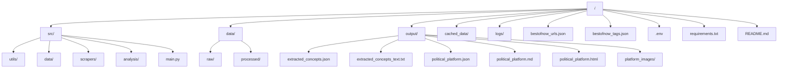
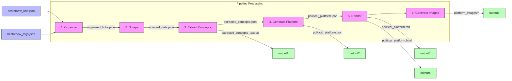

# Links Analysis Project Diagrams

## Project Structure



## Pipeline Overview

```mermaid
flowchart TD
    start([Start]) --> organize[1. Organize Links and Tags]
    organize --> scrape[2. Scrape Websites]
    scrape --> extract[3. Extract Concepts]
    extract --> analyze[4. Generate Political Platform]
    analyze --> render[5. Render Markdown and HTML]
    render --> generate[6. Generate Images]
    generate --> end([End])
    
    classDef process fill:#f9f,stroke:#333,stroke-width:2px;
    class organize,scrape,extract,analyze,render,generate process;
```

## Data Flow Diagram



## Detailed Process Flow

### 1. Organize Links and Tags

```mermaid
flowchart TD
    start([Start]) --> read[Read Input Files]
    read --> |bestofnow_urls.json| process1[Process URLs]
    read --> |bestofnow_tags.json| process2[Process Tags]
    process1 --> merge[Merge and Categorize]
    process2 --> merge
    merge --> save[Save to organized_links.json]
    save --> end([End])
```

### 2. Website Scraping

```mermaid
flowchart TD
    start([Start]) --> load[Load Organized Links]
    load --> setup[Setup Scraper]
    setup --> parallel[Parallel Processing]
    parallel --> |for each URL| request[Send HTTP Request]
    request --> extract[Extract Content]
    extract --> filter[Filter Navigation Elements]
    filter --> parse[Parse Text Content]
    parse --> save[Save to scraped_data.json]
    save --> end([End])
```

### 3. Concept Extraction

```mermaid
flowchart TD
    start([Start]) --> load[Load Scraped Content]
    load --> llm[Process with LLM]
    llm --> extract[Extract Ideas & Positions]
    extract --> categorize[Categorize Concepts]
    categorize --> structure[Structure Data]
    structure --> save1[Save JSON]
    save1 --> save2[Save Text Version]
    save2 --> end([End])
```

### 4. Political Platform Generation

```mermaid
flowchart TD
    start([Start]) --> load[Load Extracted Concepts]
    load --> analyze[Analyze Concepts]
    analyze --> categorize[Categorize by Domain]
    categorize --> synthesize[Synthesize Platform]
    synthesize --> summary[Create Executive Summary]
    summary --> structure[Structure Platform]
    structure --> save[Save to political_platform.json]
    save --> end([End])
```

### 5. Markdown and HTML Rendering

```mermaid
flowchart TD
    start([Start]) --> load[Load Political Platform]
    load --> md[Generate Markdown]
    md --> savemd[Save Markdown]
    load --> html[Generate HTML]
    html --> style[Apply Styling]
    style --> interactive[Add Interactive Elements]
    interactive --> savehtml[Save HTML]
    savemd --> end([End])
    savehtml --> end
```

### 6. Image Generation

```mermaid
flowchart TD
    start([Start]) --> load[Load Political Platform]
    load --> themes[Identify Key Themes]
    themes --> prompts[Generate Image Prompts]
    prompts --> dalle[Process with DALL-E]
    dalle --> save[Save Generated Images]
    save --> end([End])
```

## Command Line Options Flow

```mermaid
flowchart TD
    start([Start]) --> args[Parse Arguments]
    args --> cond1{only-organize?}
    cond1 -->|Yes| org[Run Organize Only]
    cond1 -->|No| cond2{only-scrape?}
    
    cond2 -->|Yes| scr[Run Scrape Only]
    cond2 -->|No| cond3{only-extract?}
    
    cond3 -->|Yes| ext[Run Extract Only]
    cond3 -->|No| cond4{only-analyze?}
    
    cond4 -->|Yes| ana[Run Analyze Only]
    cond4 -->|No| cond5{only-render?}
    
    cond5 -->|Yes| ren[Run Render Only]
    cond5 -->|No| cond6{only-images?}
    
    cond6 -->|Yes| img[Run Images Only]
    cond6 -->|No| regular[Run Regular Pipeline]
    
    regular --> skip1{skip-organize?}
    skip1 -->|Yes| skiporg[Skip Organize]
    skip1 -->|No| runorg[Run Organize]
    
    skiporg --> skip2{skip-scrape?} 
    runorg --> skip2
    
    skip2 -->|Yes| skipscr[Skip Scrape]
    skip2 -->|No| runscr[Run Scrape]
    
    skipscr --> skip3{skip-extract?}
    runscr --> skip3
    
    %% Continue for remaining skip options
    
    org --> end([End])
    scr --> end
    ext --> end
    ana --> end
    ren --> end
    img --> end
    skiporg --> end
    runorg --> end
    skipscr --> end
    runscr --> end
```
