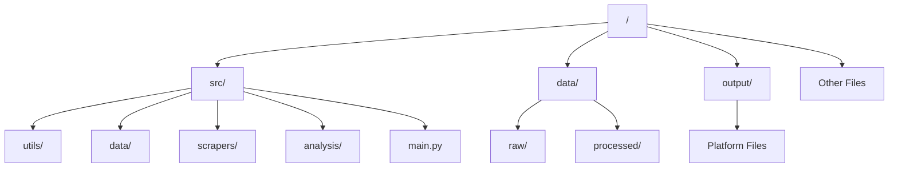
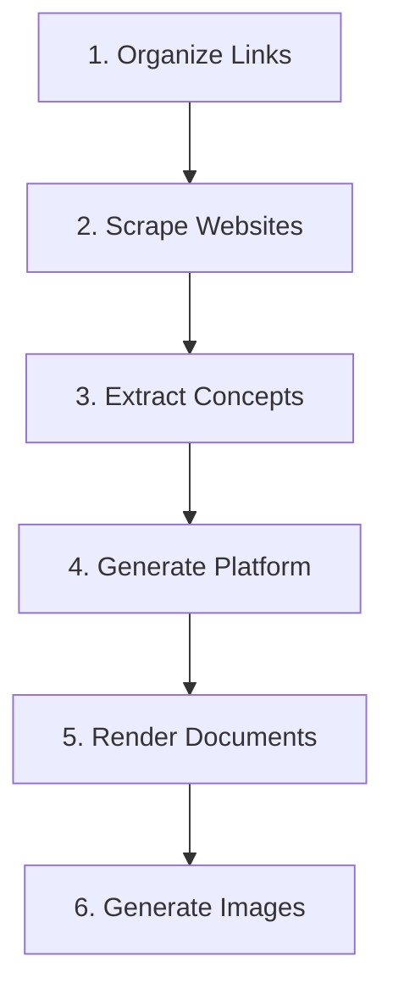
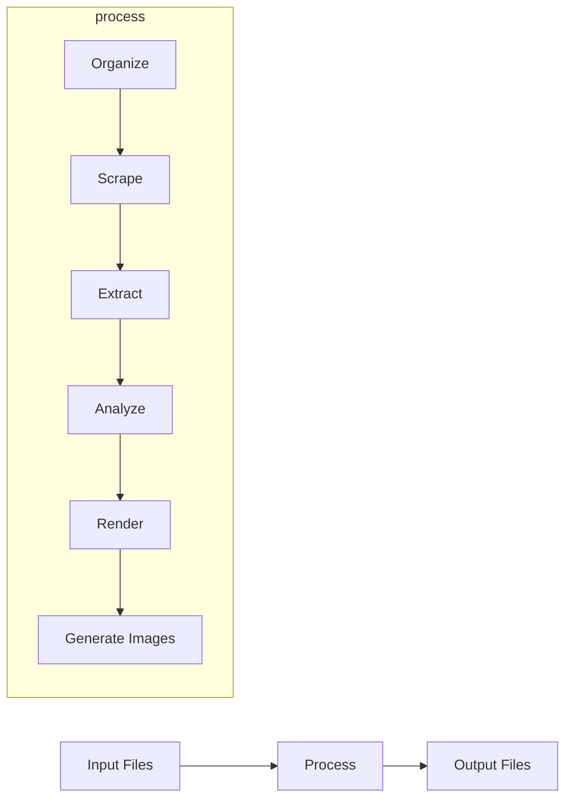
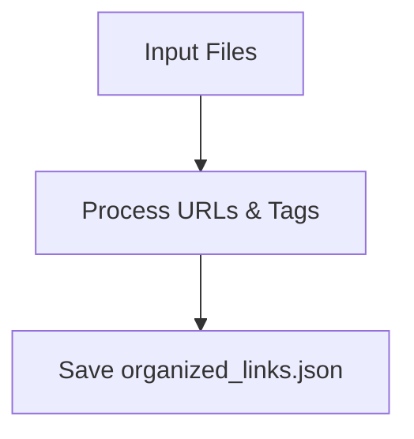
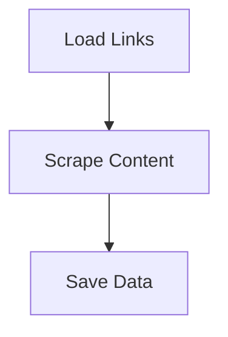
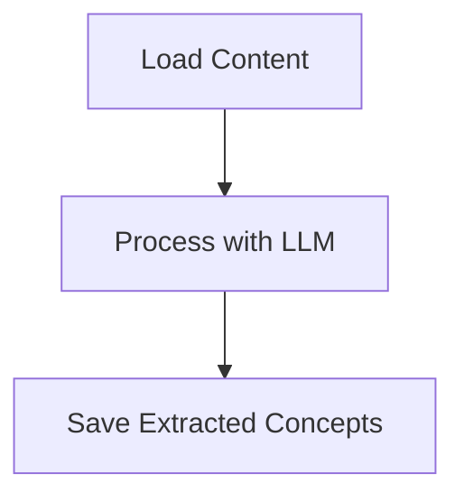
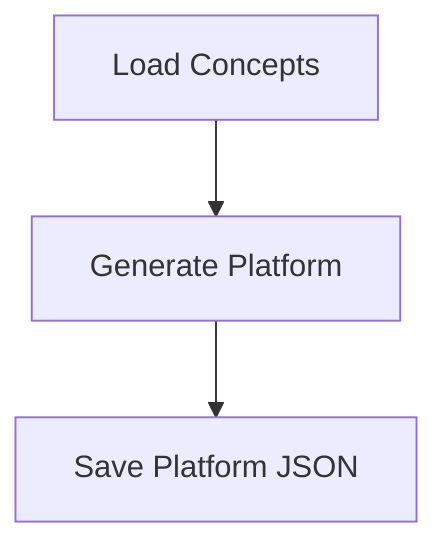
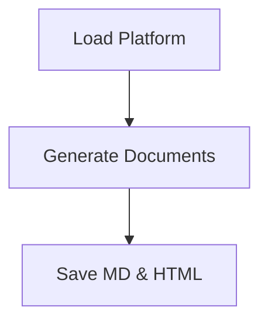
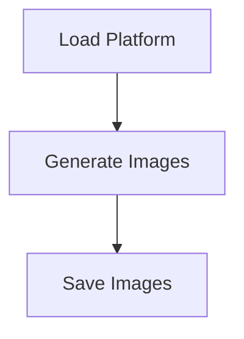
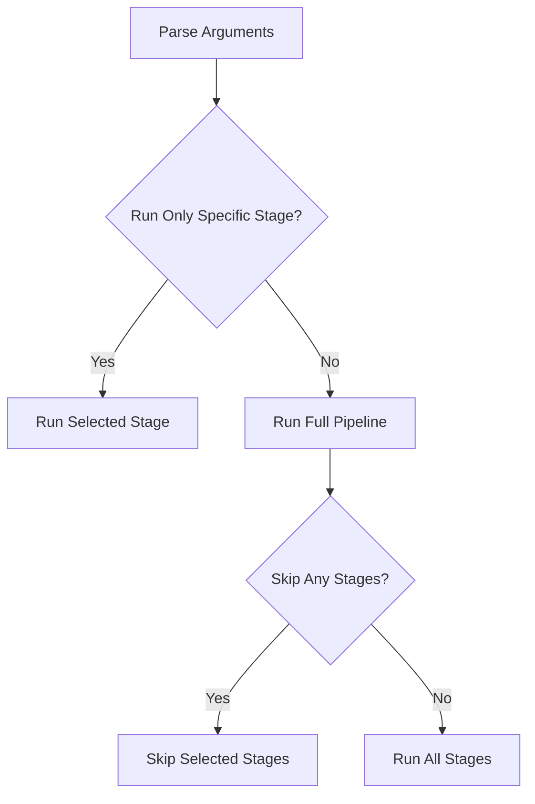

# Links Analysis Project Diagrams

## Project Structure

## Pipeline Overview

## Data Flow Diagram

## Detailed Process Flow

### 1. Organize Links and Tags

### 2. Website Scraping

### 3. Concept Extraction

### 4. Political Platform Generation

### 5. Markdown and HTML Rendering

### 6. Image Generation

## Command Line Options

