# System Architecture

Modular pipeline: scraping and file I/O are isolated from LLM stages; configuration and logging are shared via `src/utils`.

## Pipeline

Nine sequential stages. **Entry:** `src/main.py` → `src/pipeline_cli.py` (`parse_pipeline_argv`) → `src/pipeline_orchestration.py` (`run_pipeline(..., stages=PipelineStages())`).

```mermaid
flowchart LR
  main[main.py] --> cli[pipeline_cli.py<br/>parse_pipeline_argv]
  cli --> orch[pipeline_orchestration.py<br/>run_pipeline + PipelineStages]
  orch --> s1[data/organize_links.py]
  s1 --> s2[scrapers/scrape_sites.py]
  s2 --> s3[analysis/extract_concepts.py]
  s3 --> s4[analysis/organize_extractions.py]
  s4 --> s5[analysis/generate_essays.py]
  s5 --> s6[analysis/generate_essay_images.py]
  s6 --> s7[analysis/generate_platform.py]
  s7 --> s8[analysis/render_markdown.py]
  s8 --> s9[analysis/generate_images.py]
```



1. **Organize links** — `src/data/organize_links.py` → `data/organized_links.json`
2. **Scrape** — `src/scrapers/scrape_sites.py` → `data/scraped_data.json` (+ text extract); cache in `cached_data/`
3. **Extract** — `src/analysis/extract_concepts.py` → `output/extracted_concepts.json` (principles/policies/values/goals per document)
4. **Organize extractions** — `src/analysis/organize_extractions.py` → `output/site_specific/`, `output/compiled/`
5. **Essays** — `src/analysis/generate_essays.py` → `output/essays/`
6. **Essay images** — `src/analysis/generate_essay_images.py` → `output/essay_images/` (image model: `ESSAY_IMAGE_MODEL`, default `dall-e-3`; chat prompts use `GPT_MODEL`)
7. **Platform** — `src/analysis/generate_platform.py` → `output/political_platform.json`
8. **Render** — `src/analysis/render_markdown.py` → `output/political_platform.md`, `output/political_platform.html`
9. **Platform images** — `src/analysis/generate_images.py` → `output/platform_images/` (GPT-Image-1)

## Dependency graph

```
src/main.py
├── src/pipeline_cli.py          # argparse → skip kwargs
└── src/pipeline_orchestration.py # run_pipeline, PipelineStages
    ├── src/data/organize_links.py
    ├── src/scrapers/scrape_sites.py
    ├── src/analysis/extract_concepts.py
    ├── src/analysis/organize_extractions.py
    ├── src/analysis/generate_essays.py
    ├── src/analysis/generate_essay_images.py
    ├── src/analysis/generate_platform.py
    ├── src/analysis/render_markdown.py
    └── src/analysis/generate_images.py
All stages use:
├── src/utils/config.py
└── src/utils/logger.py
```

## Configuration

`src/utils/config.py` loads `.env`, defines paths, and maps `TIMEOUT` → `REQUEST_TIMEOUT`. Secrets stay in environment variables, not in code.

## Image generation (two paths)

- **Essay images** (`generate_essay_images.py`): `GPT_MODEL` builds two prompts (strict JSON); `client.images.generate` uses `ESSAY_IMAGE_MODEL` (default `dall-e-3`).
- **Platform images** (`generate_images.py`): prompts from platform JSON; model `gpt-image-1` is hardcoded in the module (`IMAGE_MODEL` from config is currently unread).

## Error handling

Scraping logs per-URL failures and continues where possible. Essay image generation fails the stage if prompt JSON is invalid or image download/generation errors (no silent fallbacks). Other LLM stages may catch exceptions and embed error strings in outputs.

## Testing

Unit tests target pure helpers and boundaries; integration tests use temporary dirs and mocks for `main()` entry points. See [TESTING.md](TESTING.md).
